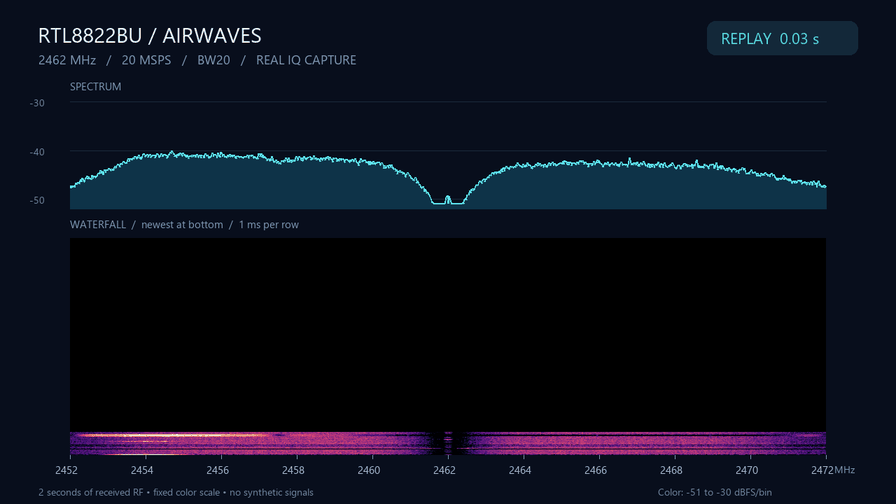
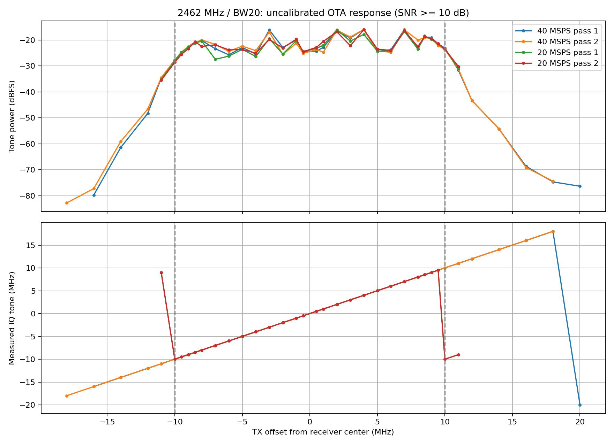

# ASUS USB-AC54 as an SDR

Experimental raw I/Q reception from an ASUS USB Wi-Fi adapter (`0b05:1841`,
Realtek RTL8822BU family), using WinUSB/libusb and custom RAM firmware.
**20 MSPS streaming has passed a 60-second run** with packet-order, overlap,
deadline and freshness checks. RF performance is still being characterized.

## A little bit of air

[](docs/media/waterfall.mp4)

**[Watch / download the MP4](docs/media/waterfall.mp4)** · 1280×720, 30 fps,
2 seconds of real received IQ at **2462 MHz / BW20**. The GIF is a looping
preview; the recording contains 39,993,344 samples and passed every stream
integrity check. Colors use a fixed scale. [Capture details](docs/media/waterfall-capture.txt).

## Frequency response



Pluto TX1 swept **2442–2482 MHz** with the receiver fixed at 2462 MHz:
38 frequencies, forward/reverse passes, and 20/40-MSPS snapshots.
The response falls steeply beyond roughly ±10 MHz. At 20 MSPS, a tone at
**+11 MHz folds to −8.964 MHz**, also verified in the continuous CPU stream.

This is an **uncalibrated over-the-air link response**, including antennas,
multipath and receiver gain behavior. It does not establish receiver-only
ripple or a precise −3 dB bandwidth. 5 GHz has not been swept.
[Measurement report (Russian)](docs/frequency-response.md) ·
[CSV data](artifacts/response-24g/analyzed.csv)

## Current state

- **20 MSPS:** verified for 60 seconds in the recorded validation run;
  USB scheduling outliers can still stop captures. Checks fail explicitly.
- **40 MSPS:** snapshots and short streaming bursts work; sustained streaming
  is not established.
- **SDR++:** the SpyServer interface works through an earlier capture path;
  the CPU streamer is not integrated into it yet.
- **RF:** I/Q orientation and aliasing verified at 2.4 GHz. Gain control,
  calibration, other channels and bandwidths need more work.

## Build and capture

Windows, MSVC, Windows SDK, a WinUSB-bound adapter and USB 3 are required.
The libusb runtime and development files are included in `tools/`.
The CPU firmware also needs local `tmp/vendor-imem.bin`; see
[setup and firmware extraction](HANDOFF.md). Run only one hardware tool at a time.

```bat
cd tools
mk.bat cpustream
cpustream.exe 2 2 cap\capture.cs16 1 1
```

This records two seconds at 20 MSPS with CCK disabled and WinUSB RAW_IO.
Output is interleaved little-endian signed 16-bit I/Q. Firmware is loaded
into RAM; no flash or efuse writes are needed.

For measurement and rendering, use Python with NumPy, Matplotlib, Pillow and
`imageio-ffmpeg`. The entry points are [measure_response.py](tools/measure_response.py)
and [render_waterfall.py](tools/render_waterfall.py).

## Repository map

| Path | Contents |
| --- | --- |
| `tools/` | Device tools, build scripts, analysis scripts and validation logs |
| `docs/` | Protocol notes, measurement report and demo media |
| `analysis/ghidra/` | Driver investigation scripts |
| `artifacts/` | Driver reference files and measurement tables/plots |

[HANDOFF.md](HANDOFF.md) contains detailed findings, commands and limitations.
[PLAN.md](PLAN.md) is the historical plan. Large raw recordings, external
sources and scratch projects stay local in ignored paths; the plots, tables,
logs and demo video are included here.
